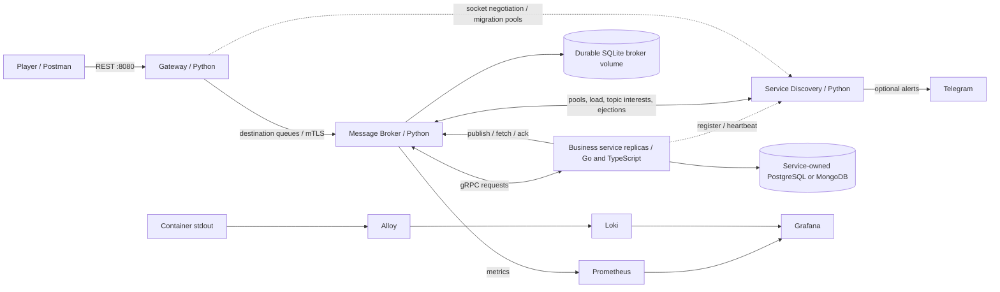

# Deployment architecture

One Compose deployment runs the eight business services, Gateway, Service Discovery,
Message Broker, PostgreSQL, MongoDB and monitoring. Business services have three replicas.
Each service owns its data and runs its workers inside its API process.

This is the target flow for migrated owners. During migration, Gateway still routes
unmigrated destinations directly and their events remain on Kafka. The default switches
include User Management, Battle, Map, Monster Raid, Tamagotchi and Notification. Guild and
Package Registry require their owners' compatible releases before the final switch.
Kafka's Registry consumer cannot receive User Management events published only to the new broker.

## Responsibilities

| Component | Responsibility | Storage |
| --- | --- | --- |
| Gateway | Client authentication, public route catalog, signed player identity, deadlines and socket negotiation | None |
| Service Discovery | Registration, health/load polling, topic interests, instance pools and ejection recovery | In memory; rebuilt from heartbeats |
| Message Broker | Destination queues, gRPC routing, load-based selection, breakers, safe rerouting, durable events, retries and dead letters | SQLite WAL in `broker-data` |
| User Management | Accounts, relationships, enrollments, wallets, holds and rewards | PostgreSQL `users` |
| Battle | Challenges, turns, frozen combat inputs, deadlines and settlement progress | PostgreSQL `battles` |
| Map | Locations and nearby encounters | PostgreSQL `locations` |
| Monster Raid | Raids, participants, attacks and rewards | PostgreSQL `raids` |
| Guild | Membership, invitations, roles and chat | PostgreSQL `guilds` |
| Package Registry | Packages, configurations, combat rules and raid schedules | MongoDB `registry` |
| Tamagotchi | Pets, care, XP, reservations and ownership | PostgreSQL `tamagotchi` |
| Notification | Devices and notification delivery | PostgreSQL `notification` |
| Kafka | Events for owners still migrating | `kafka-data` |
| Prometheus, Loki, Alloy, Grafana | Metrics, container logs and dashboards | Named monitoring volumes |

## Networking and trust

Players use `http://localhost:8080/services/{service}/{path}`. Gateway verifies tokens,
removes bearer credentials and signs a short-lived identity bound to method, URI and body.
It sends migrated requests to `https://message-broker:8443/queues/{service}/{path}`.
The broker forwards the identity to the owner, which checks permissions.

Services call `message-broker:50051` using mutual TLS and `Router.Call`. The broker derives
the caller from its certificate and checks the shared route allowlist. It signs a service
identity and calls the destination's `Endpoint.Handle` on its registered gRPC port. The
adapter uses the existing HTTP handler, keeping validation and idempotency unchanged.
Only the broker certificate can call an owner's gRPC endpoint. A broker-issued identity
cannot act as a player. HTTPS remains a temporary fallback for owners without `grpcPort`.

`BROKER_SERVICES` selects Gateway destinations and `BROKER_DESTINATIONS` selects outgoing
calls. Unlisted dependencies use their explicitly configured legacy Gateway URL; a failed
broker call never falls back. Empty lists mean all destinations. Once every owner migrates,
Gateway removes internal routes and rejects service callers. Do not enable that state early.

Registration, heartbeats and pool reads go directly over mTLS to
`https://service-discovery:8443`. They are control-plane traffic, not business requests.
JWKS reads also use the broker when User Management is selected.

Business services publish no host REST or gRPC ports. Guild ports 8087–8089 and Monster Raid
8084–8086 are reserved for negotiated WebSockets with single-use tickets. Grafana and
Prometheus bind only to localhost, on ports 3000 and 9090. Databases and broker stay private.

## Durability and failover

A business change and its outbox event commit together. One PostgreSQL advisory-lock leader
per Go service runs workers and publishes with stable event IDs. Broker acknowledgment
means the event is on disk. Retry with the same ID after an outage; duplicates are success.
Consumers commit their inbox/domain change before Ack. Failed leases and Nack retry with
backoff; poison or exhausted messages enter the dead letter channel.

The broker uses reported load plus local in-flight work to select replicas. Per-instance
breakers open after three transport/timeout/5xx failures in the configured window. Caller
errors do not count. Failover retries reads and idempotent writes within one deadline;
post-dispatch failures never prove an unkeyed mutation was unprocessed.

Owner data, broker queues and monitoring persist in named volumes. Database provisioning
creates missing databases/roles; owner migrations update schemas separately. Seeds preserve
existing data. `down` retains volumes. Compose restart policies restart crashed processes;
Discovery tracks availability and the broker routes around failed instances.

## Extending and releasing

Each owner adds gRPC transport, broker trust and its event client, registers `grpcPort` and
any consumer interests, and publishes a validated merged `4.x.y` image. Producers name topics,
not consumers. User Management and Battle produce events but subscribe to none.

Add the owner to migration switches after its image supports broker identity. Verify its
workflow, outage recovery and events before removing its Kafka settings. Remove Kafka only
when all producers and consumers migrate. Update CPR submodule pointers to actual merged
commits after service PRs merge; feature commits are not releases.

The single-PC deployment uses Compose, one PostgreSQL, MongoDB, and one broker with a
persistent volume. Broker-process replication, Kubernetes and autoscaling are future work;
this lab's service high availability is rerouting between business-service replicas.
