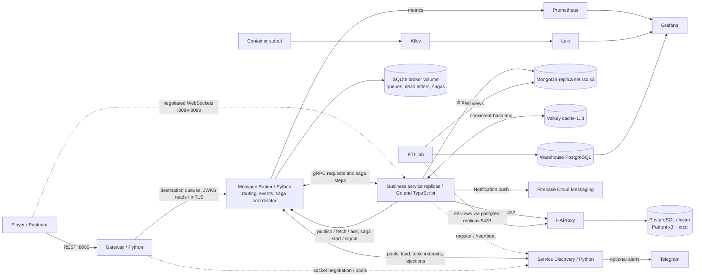

# Deployment architecture

One Compose deployment runs the eight business services, Gateway, Service Discovery,
Message Broker, a replicated PostgreSQL cluster, a MongoDB replica set, a sharded cache,
a data warehouse with its ETL job, and monitoring. Business services have three replicas.
Each service owns its data and runs its workers inside its API process.

This is the flow for every owner. The default switches include all eight: User Management,
Battle, Guild, Package Registry, Map, Monster Raid, Tamagotchi and Notification. Gateway would
still route a destination removed from the switches directly. Every event goes through the
broker, so Kafka is no longer deployed.

## Responsibilities

| Component | Responsibility | Storage |
| --- | --- | --- |
| Gateway | Client authentication, public route catalog, signed player identity, deadlines and socket negotiation | None |
| Service Discovery | Registration, health/load polling, topic interests, instance pools and ejection recovery | In memory; rebuilt from heartbeats |
| Message Broker | Destination queues, gRPC routing, load-based selection, breakers, safe rerouting, durable events, retries, dead letters and saga coordination | SQLite WAL in `broker-data` |
| User Management | Accounts, relationships, enrollments, wallets, holds and rewards | PostgreSQL `users` |
| Battle | Challenges, turns, frozen combat inputs, deadlines and settlement progress | PostgreSQL `battles` |
| Map | Locations and nearby encounters | PostgreSQL `locations` |
| Monster Raid | Raids, participants, attacks and rewards | PostgreSQL `raids` |
| Guild | Membership, invitations, roles and chat | PostgreSQL `guilds` |
| Package Registry | Packages, configurations, combat rules and raid schedules | MongoDB `registry` |
| Tamagotchi | Pets, care, XP, reservations and ownership | PostgreSQL `tamagotchi` |
| Notification | Devices and notification delivery | PostgreSQL `notification` |
| PostgreSQL cluster (Patroni ×3, etcd, HAProxy) | One primary and two replicas for every PostgreSQL database; automatic failover; `postgres:5432` primary, `postgres-replicas:5433` read-only | `postgres-1-data` to `postgres-3-data`, `etcd-data` |
| MongoDB `rs0` (3 members) | Package Registry's database with majority writes and elections | `mongo-1-data` to `mongo-3-data` |
| Valkey `cache-1` to `cache-3` | Shared cache, sharded by the clients' consistent-hash ring | None: memory only |
| Warehouse and ETL | Star schema for analytics, filled every 5 minutes from the owners' `etl` views | `warehouse-data` |
| Prometheus, Loki, Alloy, Grafana | Metrics, container logs and dashboards, including game analytics from the warehouse | Named monitoring volumes |

## Networking and trust

Players use `http://localhost:8080/services/{service}/{path}`. Gateway verifies tokens,
removes bearer credentials and signs a short-lived identity bound to method, URI and body.
It sends migrated requests to `https://message-broker:8443/queues/{service}/{path}`.
The broker forwards the identity to the owner, which checks permissions.

Services call `message-broker:50051` using mutual TLS and `Router.Call`. The broker derives
the caller from its certificate and checks the shared route allowlist. It signs a service
identity and calls the destination's `Endpoint.Handle` on its registered gRPC port. The
adapter uses the existing HTTP handler, keeping validation and idempotency unchanged.
Only the broker certificate can call an owner's gRPC endpoint. A broker-issued identity
cannot act as a player. HTTPS remains a temporary fallback for owners without `grpcPort`.

`BROKER_SERVICES` selects Gateway destinations and `BROKER_DESTINATIONS` selects outgoing
calls. Unlisted dependencies use their explicitly configured legacy Gateway URL; a failed
broker call never falls back. Empty lists mean all destinations. Every owner has migrated, so
both lists default to empty: Gateway removes internal routes and rejects service callers.

Registration, heartbeats and pool reads go directly over mTLS to
`https://service-discovery:8443`. They are control-plane traffic, not business requests.
JWKS reads also use the broker when User Management is selected.

Business services publish no host REST or gRPC ports. Guild ports 8087–8089 and Monster Raid
8084–8086 are reserved for negotiated WebSockets with single-use tickets. Grafana and
Prometheus bind only to localhost, on ports 3000 and 9090, as do the HAProxy statistics page
(7000) and the warehouse (5434). Service databases, cache nodes and the broker stay private.

## Durability and failover

A business change and its outbox event commit together. One PostgreSQL advisory-lock leader
per Go service runs workers and publishes with stable event IDs. Broker acknowledgment
means the event is on disk. Retry with the same ID after an outage; duplicates are success.
Consumers commit their inbox/domain change before Ack. Failed leases and Nack retry with
backoff; poison or exhausted messages enter the dead letter channel.

The broker uses reported load plus local in-flight work to select replicas. Per-instance
breakers open after three transport/timeout/5xx failures in the configured window. Caller
errors do not count. Failover retries reads and idempotent writes within one deadline;
post-dispatch failures never prove an unkeyed mutation was unprocessed.

Owner data, broker queues and monitoring persist in named volumes. Database provisioning
creates missing databases/roles; owner migrations update schemas separately. Seeds preserve
existing data. `down` retains volumes. Compose restart policies restart crashed processes;
Discovery tracks availability and the broker routes around failed instances.

**Database replication** ([contract](contracts/replication.md)). Patroni keeps one PostgreSQL
primary per cluster, holding a leader lock in etcd, and two streaming replicas, one of them
synchronous. A confirmed commit is therefore on two nodes. When the primary stops renewing
its lock, a replica is promoted, normally within 30 seconds; HAProxy moves `postgres:5432` to
it and closes sessions to the old primary. Services reconnect, retry reads and keyed writes
once, and advisory-lock leaders compete again. MongoDB elects a new primary by majority vote.

**Cache** ([contract](contracts/cache.md)). The cache only holds copies. Owners delete keys
after commits, every key has a TTL, and an unavailable node is a miss, never an error. The
consistent-hash ring sends a lost node's keys to its neighbours and leaves every other key
in place.

**Battle saga** ([contract](contracts/transactions.md)). The broker stores each saga step in
SQLite before calling it and resumes unfinished sagas after a restart. Steps carry stable
idempotency keys. Before the battle result, failures are compensated in reverse; after it,
settlement steps are retried until they succeed and are never reversed.

## Analytics

The ETL job reads only the `etl` views that each owner publishes ([contract](contracts/data-warehouse.md)),
through a read-only role on the replicas, so analytics never load a primary or depend on
private tables. It upserts into the warehouse's star schema with per-view watermarks, so
reruns are harmless and an unavailable source only delays its own tables. The warehouse can
be rebuilt from the sources at any time.

## Extending and releasing

Each owner adds gRPC transport, broker trust and its event client, registers `grpcPort` and
any consumer interests, and publishes a validated merged `4.x.y` image. Producers name topics,
not consumers. User Management and Battle produce events but subscribe to none.

For Lab 5, each owner adds the cache client and its ring test, its `etl` views, and the
reconnect behaviour from the replication contract, then publishes `5.x.y`. Battle starts and
signals its saga instead of calling User Management and Tamagotchi directly. Each contract
ends with a table of what every owner changes.

Add an owner to the migration switches after its image supports broker identity, and verify its
workflow, outage recovery and events through the broker. Kafka was removed once every producer
and consumer had migrated. Update CPR submodule pointers to actual merged commits after service
PRs merge; feature commits are not releases.

The single-PC deployment uses Compose, one PostgreSQL, MongoDB, and one broker with a
persistent volume. Broker-process replication, Kubernetes and autoscaling are future work;
this lab's service high availability is rerouting between business-service replicas.
